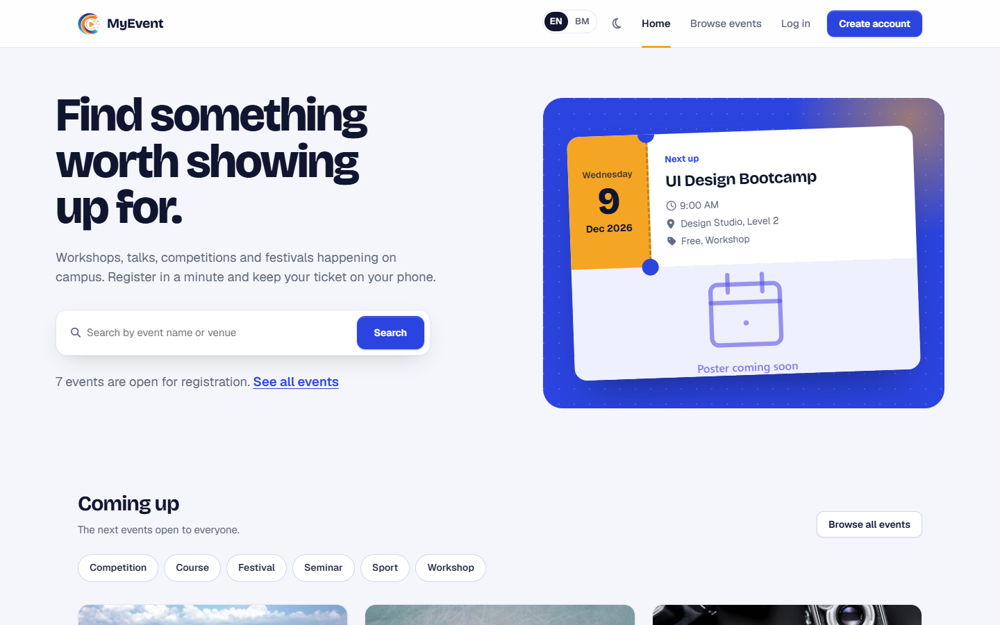
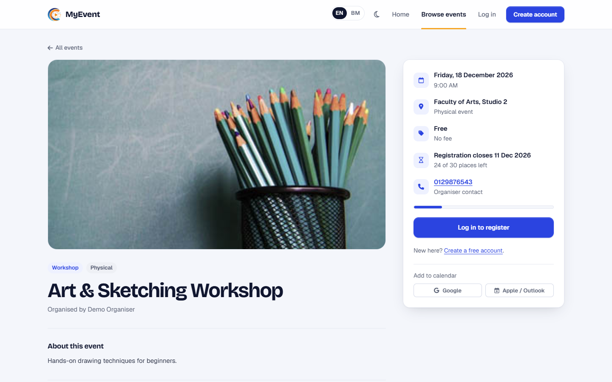
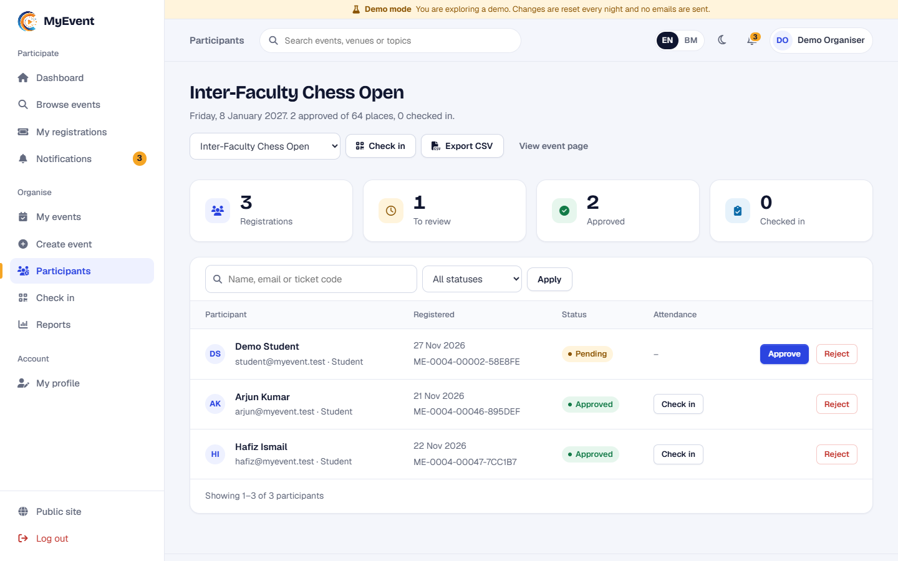
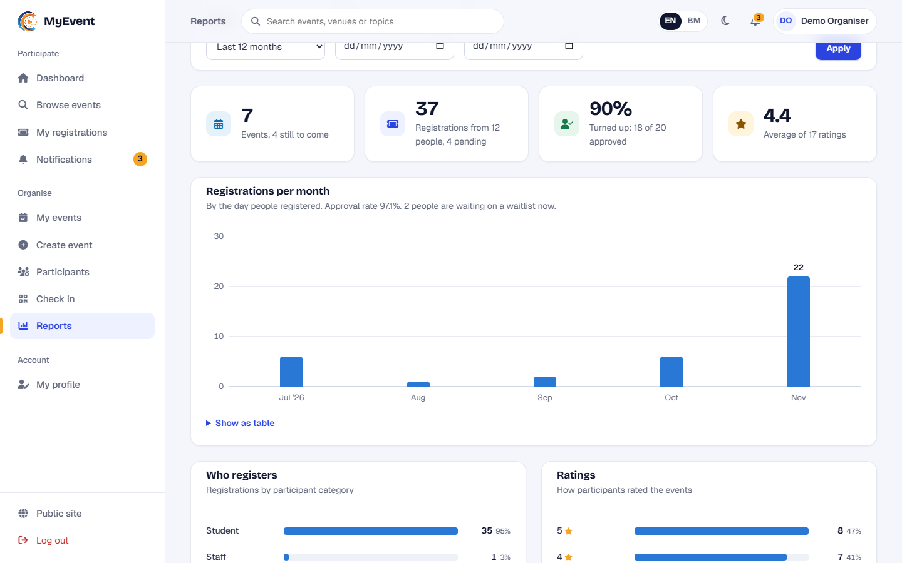
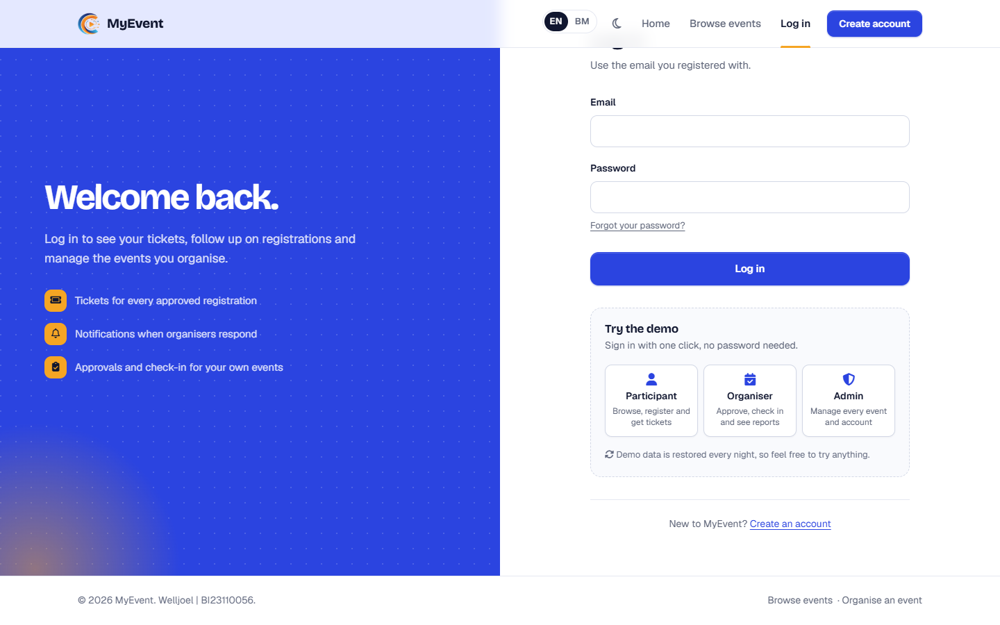

# MyEvent

Campus event management system: event announcement, registration, organiser
approval, attendance tracking, notifications and participant exports.

[](https://github.com/wilanwell/myevent/actions/workflows/ci.yml)

**Live demo: [myevent-demo.alwaysdata.net](https://myevent-demo.alwaysdata.net)**. On the login page, use
*Try the demo* to sign in with one click as a participant, an organiser or an admin. No account is needed,
and the demo data is restored every night.



## Highlights

- **Full event lifecycle:** organisers publish events. Participants register, then wait for approval or join a
  waitlist that promotes them automatically. They receive a signed QR ticket, are checked in at the door,
  and rate the event afterwards.
- **Three roles:** participant, organiser (each user can organise their own events) and administrator. Every
  page and action checks access.
- **Reports:** registrations per month, attendance and approval rates, ratings and categories, drawn with
  accessible HTML/CSS charts. Reports can be exported to CSV or printed to PDF.
- **Email and in-app notifications:** a mail outbox queue with retries and SMTP support, plus event reminders.
  Messages are sent in each recipient's language.
- **Bilingual interface:** English and Bahasa Melayu, covering 698 strings, dates and emails. A CI check fails
  the build when a string is untranslated.
- **Security:** CSRF protection on every POST, a strict Content-Security-Policy with nonces, hardened sessions,
  login throttling and safe image uploads. Only `public/` is served as the web root, and an audit log records
  admin actions.
- **Tested:** 130 PHPUnit tests (unit and integration, against a throwaway database) and 107 end-to-end HTTP
  checks, run by GitHub Actions on PHP 8.2 and 8.3.

| Event page | Organiser: review and check-in |
|---|---|
|  |  |
| **Reports** | **One-click demo sign-in** |
|  |  |

Built with plain PHP 8 and MySQLi, with no framework, so the routing, security, mail queue, i18n and charts are
all visible in the code. See [Project layout](#project-layout) for where everything lives.

**Stack:** PHP 8.1+ (mysqli), MariaDB 10.4+ / MySQL 8.0+, Apache 2.4 (`mod_rewrite`/`.htaccess` enabled). Web root: `public/`.

> Deploying to a real server? Follow **[DEPLOY.md](DEPLOY.md)** and finish with `php tools/check_production.php`.

## Installation (XAMPP / local)

1. Put the project in `htdocs/myevent`.
2. Copy the environment file and adjust it:
   ```
   cp .env.example .env
   ```
   For local development set `APP_DEBUG=true`. **Never enable debug on a public server.**
3. Create the database and load the schema:
   ```
   mysql -u root -e "CREATE DATABASE myevent CHARACTER SET utf8mb4 COLLATE utf8mb4_general_ci"
   mysql -u root myevent < database/schema.sql
   mysql -u root myevent < database/seed.sql   # optional demo data
   ```
4. Open http://localhost/myevent. (The root `.htaccess` routes requests into `public/`, so the address has no `/public`.)

Generate `APP_KEY` (signs ticket QR codes) and put it in `.env`:
```
php -r "echo bin2hex(random_bytes(32));"
```

Demo accounts created by `seed.sql` are listed at the top of that file.
Delete or change them before going live.

## Upgrading an existing database

Apply the files in `database/migrations/` that have not been run yet, in filename order:
```
mysql -u root myevent < database/migrations/<file>.sql
```
`database/schema.sql` always reflects the schema after the latest migration.
Back up first (`mysqldump -u root myevent > backup.sql`).

## Participant features

- **Waitlist.** When an event is full and registration is still open, people can join a
  first-come-first-served waitlist. When a place frees up (a cancellation, a rejection, or a
  higher capacity), the first person in line becomes a *Pending* registration automatically and
  is notified; the organiser approves as usual. Logic lives in `include/waitlist.php`.
- **Feedback.** Participants with an approved registration can rate an event (1 to 5 stars, with an
  optional comment) once it has started, and edit it later. The average rating is public on the
  event page; comments are visible only to the organiser and admins.
- **Add to calendar.** Event pages and tickets link to Google Calendar and to a downloadable
  `.ics` file (`event_calendar.php`) for Outlook and Apple Calendar, with a reminder one hour before.
  Organisers can set an optional end time; without one, calendars assume two hours.

## Demo mode (public showcase)

For a portfolio or recruiter demo, set `APP_DEMO=true` (and `MAIL_DRIVER=log`) in `.env`:

- The login page gains a **Try the demo** box: one click signs in as the seeded participant,
  organiser or admin (`student@` / `organiser@` / `admin@myevent.test`), no password needed.
- Every signed-in page shows a thin **Demo mode** band.
- The demo accounts are protected: no password changes, and admins cannot edit or delete them.
- `php tools/demo_reset.php --yes` empties every table and deletes the uploads that database used, then loads
  `database/seed.sql` and `database/demo.sql` (past events with attendance and ratings, a full
  event with a waitlist, pending requests). Run it nightly from cron. It refuses to run unless
  `APP_DEMO=true`, so it can never wipe a real site.

With `APP_DEMO=false` (the default) none of this exists: `auth/demo_login.php` returns 404.
Logic lives in `include/demo.php`.

## Reports

**Admin → Reports** covers every event (optionally one organiser); **Organise → Reports** shows an organiser
their own events only. Both offer a period filter (last 30 / 90 days, 12 months, all time or custom dates,
by event date) and show:

- headline numbers: events, registrations and unique people, attendance rate, average rating
- registrations per month (with a table view), registrations by participant category, rating distribution
- a per-event table: registrations against capacity, attendance, rating and waitlist

**Export CSV** downloads the per-event table (every event, not just the 50 shown) and **Print or save PDF**
prints a clean copy (sidebar and filters hidden), which the browser can save as PDF. Admin exports are written
to the audit log. Definitions: *registrations* are pending + approved places; *attendance* is checked-in ÷ approved,
only for events that have taken place. Queries live in `include/reports.php`; charts are plain HTML/CSS
(no chart library), with hover and keyboard focus showing exact values.

## Languages (English / Bahasa Melayu)

The whole interface, every email and the dates (day and month names, PG/PTG) are available in English and
Bahasa Melayu. The **EN | BM** switch sits in the top bar and the public menu.

Which language is used: the account's choice (saved when someone switches, or the language in use when they
registered) → the visitor's earlier choice (session, one-year cookie) → the browser's `Accept-Language` → `APP_LOCALE`
(default `en`). Notifications and emails are written in the **recipient's** language, whoever triggers them.

**Adding or changing text:** write it in English and wrap it:

```php
<?= t('Register for this event') ?>                          // escaped, for HTML
<?= t('Organised by {name}', ['name' => $organiser]) ?>      // placeholders
flash('success', __('Event published.'));                    // plain text
<?= e(_n('{n} place left', '{n} places left', $left)) ?>     // plurals
<?= e(ldate('l, j F Y', $event['event_date'])) ?>            // translated day and month names
```

Then add the Malay text to `lang/ms.php`. `php tools/i18n.php` lists what is missing (`--missing` prints
ready-to-fill lines) and CI fails until every string is translated and no stale ones remain. Text stored by users
(event names, categories, descriptions) is shown as entered.

## Email notifications

Every notification appears under the bell icon and, unless the person switched it off in
*My profile → Email notifications*, also as a branded HTML email (with a plain-text version):

| Who | When |
|---|---|
| Participant | Registration approved (with ticket link) or not approved; moved off the waitlist; reminder ~24 hours before the event; the event's date, time or venue changed; the event was cancelled |
| Organiser | Someone registered; someone moved up from the waitlist |

Calls go through `notify_user()` in `include/notify.php`. In development (`MAIL_DRIVER=log`) emails are
written to `storage/mail/` (`.eml`, `.txt` and `.html` copies) straight away. In production they are queued and
sent by `php tools/send_mail.php` every 5 minutes (see DEPLOY.md), which also queues the reminders.

## Time zone

`APP_TIMEZONE` (default `Asia/Kuala_Lumpur`) is applied to both PHP and the MySQL session, so
"today", registration deadlines and timestamps agree everywhere.

## Email

`MAIL_DRIVER=log` (development) saves every email to `storage/mail/` instead of sending it.
With `APP_DEBUG=true` the password-reset screen also shows the link. For a real server set:

```
MAIL_DRIVER=smtp
SMTP_HOST=smtp.gmail.com      # or your provider
SMTP_PORT=587
SMTP_ENCRYPTION=tls           # tls = STARTTLS on 587, ssl = port 465
SMTP_USERNAME=you@example.com
SMTP_PASSWORD=app-password
MAIL_FROM=no-reply@example.com
```

## Tickets and check-in

Approved participants get a ticket with a QR code and a code such as `ME-0044-00012-7F3A9C`.
The last part is an HMAC signature made with `APP_KEY`, so codes cannot be guessed or edited.
The QR opens `users/checkin.php`; the organiser (or an admin) confirms the check-in there.
Scanning with any phone camera works. The phone must be able to reach `APP_URL`, so for
testing on a phone over Wi-Fi set `APP_URL` to the computer's LAN address, e.g. `http://192.168.1.20/myevent`.

## Tests

Three layers, all run by CI (`.github/workflows/ci.yml`) on every push and pull request:

| Layer | What it covers | Needs |
|---|---|---|
| **Lint** `php tools/lint.php` | Every PHP file parses | PHP only |
| **PHPUnit** `vendor/bin/phpunit` | 125 tests: escaping, CSRF, signed tickets, calendar files, email building, waitlist promotion, mail queue retries, notification preferences, reminders, login throttling, audit log, report figures and charts, translations and per-recipient email language | MySQL/MariaDB |
| **End-to-end** `bash tests/e2e.sh` | 107 HTTP checks against the running app: web root isolation, demo mode off by default, CSRF, uploads, access control, approvals, check-in, password reset, sessions, brute force | Apache + MySQL |

### First time

Install [Composer](https://getcomposer.org/download/), then in the project folder:
```
composer install
```
(XAMPP without Composer on PATH: `C:\xampp\php\php.exe -d extension=zip composer.phar install`.)
`vendor/` holds test tools only; the app itself does not need it, so a production server can skip this step.

### Running

```
bash tests/run.sh          # lint + PHPUnit + end-to-end, like CI
bash tests/run.sh --fast   # lint + PHPUnit only (no web server needed)
vendor/bin/phpunit --testsuite unit          # just the fast unit tests
vendor/bin/phpunit --filter Waitlist         # one area
```
On Windows prefix the PHP commands with `C:\xampp\php\php.exe` (for example `C:\xampp\php\php.exe vendor\bin\phpunit`).

**Your data is safe.** PHPUnit uses a separate database, `myevent_test`, which it drops and rebuilds from
`database/schema.sql` at the start of every run (it refuses any name that does not end in `_test`). The host
and credentials come from `.env`, or from `DB_HOST` / `DB_USERNAME` / `DB_PASSWORD` in the environment.
Test emails go to a temporary folder, never to `storage/mail`.
The end-to-end suite runs against the real app and database: it creates throwaway `qa_*@example.test`
accounts and removes them afterwards. Override `BASE`, `MYSQL`, `MYSQL_OPTS`, `DB` or `PHP` if your setup differs.

### Writing a test

- Pure functions go in `tests/Unit` (extend `PHPUnit\Framework\TestCase`).
- Anything that reads or writes the database goes in `tests/Integration` and extends
  `MyEvent\Tests\Support\DatabaseTestCase`: every test starts with empty tables; create rows with
  `makeUser()`, `makeEvent()`, `register()` and `joinWaitlist()`.
- Assert on emails with `MyEvent\Tests\Support\MailSpy::messages()` / `recipients()`.
- New table or column? Update `database/schema.sql` (the tests build from it) as well as adding a migration.

## Project layout

Only `public/` is served by the web server; everything else (code, `.env`, data, tools) sits outside the web root.

```
myevent/
├── public/                 web root: the only folder reachable over HTTP
│   ├── index.php, browse_events.php, event_detail.php, event_calendar.php, lang.php, health.php
│   ├── auth/  users/  admin/   pages (participant, organiser and admin areas)
│   ├── assets/             css/, js/, img/
│   └── uploads/            event posters and profile photos (scripts blocked)
├── config.php              bootstrap, loaded by every page
├── include/                application code (security, helpers, mailer, notifications, waitlist, reports, i18n)
│   ├── layout/  partials/
├── lang/ms.php             Malay translations
├── database/               schema.sql, seed.sql, migrations/
├── storage/                logs/, backups/, mail/ (runtime data)
├── tools/                  command-line jobs: send_mail, backup, maintenance, demo_reset, check_production, lint, i18n
├── tests/                  PHPUnit (Unit, Integration, Support), e2e.sh, run.sh
├── .github/workflows/      CI
├── .env                    local settings (never committed)
└── .htaccess               fallback: routes every request into public/
```

| Path | Purpose |
|---|---|
| `config.php` | Bootstrap: `.env`, error handling, hardened session, language, DB connection, CSRF check for every POST. Defines `ROOT_PATH` (project) and `PUBLIC_PATH` (web root) |
| `include/security.php` | `e()`, CSRF, `require_login()` / `require_admin()`, safe image upload, login throttling |
| `include/helpers.php` | Media URLs, fee/date helpers, `datestub()`, `status_badge()`, pagination, `db_all()` / `db_value()` |
| `include/layout/` | `app_start` / `app_end` (signed-in pages with sidebar) and `public_start` / `public_end` (public pages) |
| `include/partials/` | Reusable fragments: event card, profile form, reports screen, language switch |
| `include/event_editor.php` | Create/edit event screen shared by organisers and admins |
| `include/participants_manager.php` | Review, check-in and CSV export screen shared by organisers and admins |
| `include/mailer.php`, `include/notify.php` | `send_mail()` (log and SMTP drivers), outbox queue, notifications in the recipient's language |
| `include/reports.php` | Report queries and HTML charts |
| `include/demo.php` | Demo mode: demo accounts, their guards, `demo_reset()` |
| `include/i18n.php`, `lang/ms.php`, `public/lang.php` | Translations: `__()` / `t()` / `_n()` / `ldate()`, the Malay dictionary, the EN/BM switch |
| `public/assets/css/app.css` | Design system: tokens, layout shell and components |
| `public/assets/css/public.css` | Public pages: hero, event cards, event detail, sign-in |
| `public/assets/js/app.js` | Mobile menu, confirm dialogs, image preview, chart tooltips, auto-submit filters |
| `public/auth/`, `public/users/`, `public/admin/` | Pages. Each page sets `$page_title` / `$nav_active` and includes a layout |
| `public/uploads/` | User uploads (script execution blocked by `public/uploads/.htaccess`) |
| `public/health.php` | Uptime-monitor endpoint: `ok` / 200 when PHP and the database respond |
| `database/` | `schema.sql`, `seed.sql`, `demo.sql` (extra showcase data), `migrations/` |
| `tools/` | `send_mail.php` (cron every 5 min), `backup.php`, `maintenance.php`, `demo_reset.php`, `check_production.php`, `lint.php`, `i18n.php` |
| `tests/` | PHPUnit suites (`phpunit.xml`), `e2e.sh`, `run.sh`; CI in `.github/workflows/ci.yml` |
| `storage/logs`, `storage/backups`, `storage/mail` | Error log, backups, development mailbox |

### Adding a page

```php
<?php
require_once __DIR__ . '/../config.php';
require_login();                       // or require_admin()

$page_title = 'My page';
$nav_active = 'dashboard';             // a key from include/layout/app_start.php
include ROOT_PATH . '/include/layout/app_start.php';
?>
<div class="page-header"><div><h1>My page</h1></div></div>
<section class="card"><div class="card-body">...</div></section>
<?php include ROOT_PATH . '/include/layout/app_end.php'; ?>
```

Use the components in `app.css` (`card`, `table`, `btn`, `badge`, `field`, `empty-state`, `pagination`) instead of inline styles.

## Security conventions

- Every page includes `config.php` first. Every POST form must contain `<?= csrf_field() ?>`.
- State-changing actions use POST only. Escape all output with `e()`.
- Use prepared statements for every query that includes user input.
- Use `upload_image()` for uploads; never trust the original file name or extension.
- A Content-Security-Policy is sent on every page. Inline `<script>` blocks need `nonce="<?= e(CSP_NONCE) ?>"`,
  and inline event handlers (`onclick="..."`) are not allowed: use `public/assets/js/app.js` or a nonce'd script.
